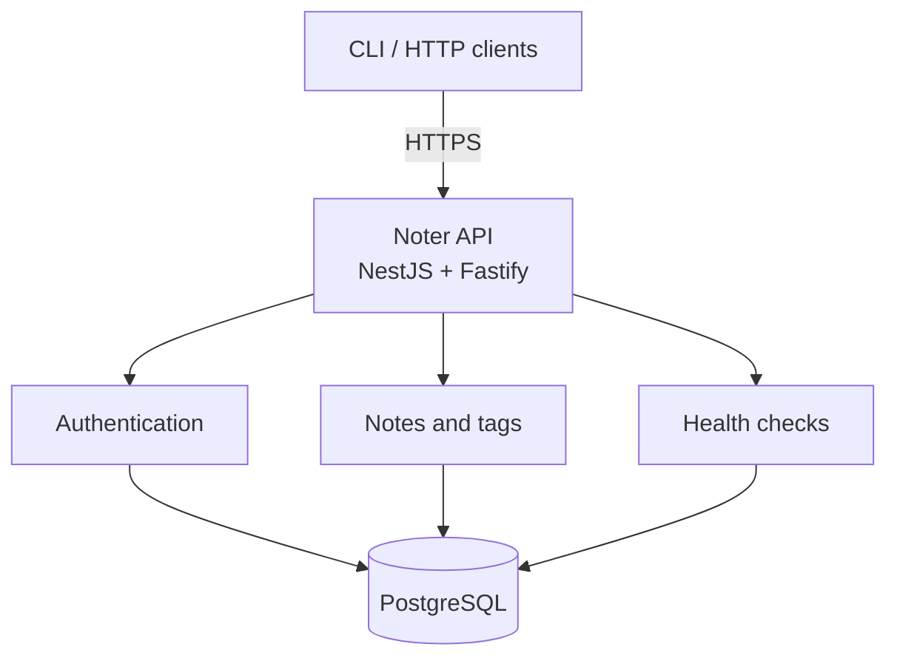
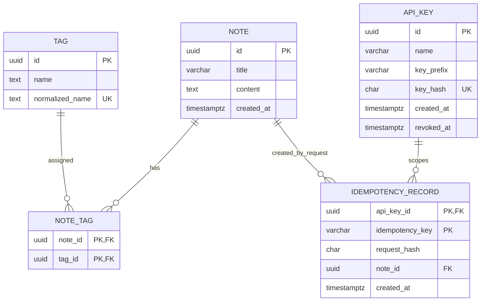
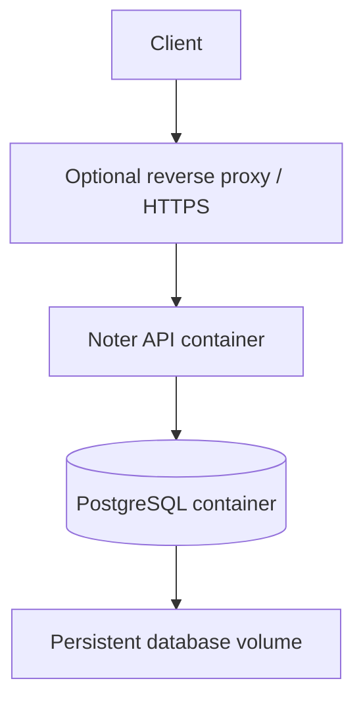

# Noter — Software Architecture Document

**Status:** Architecture baseline v1.0  
**Related document:** [Product Requirements Document](../requirements/PRD.md)  
**Architecture style:** Modular monolith

## 1. Purpose

This document describes the architecture for the Noter MVP. It translates the product requirements into an implementable technical design while keeping the system small enough for a single developer to build, operate, and maintain.

The architecture prioritizes reliability, then extensibility, simplicity, and speed. It deliberately avoids distributed infrastructure and abstractions that do not solve a current requirement.

## 2. Architecture overview

Noter is one deployable HTTP API application backed by one PostgreSQL database.



### 2.1 Architectural decisions

- **Modular monolith:** one application and one deployment unit, internally divided into modules.
- **API-first:** clients communicate through a versioned HTTP API; client-specific behavior does not belong in the domain layer.
- **PostgreSQL as source of truth:** all persistent application state is stored in PostgreSQL.
- **No distributed components in the MVP:** no Redis, Kafka, Elasticsearch, Kubernetes, microservices, or additional database.
- **Replaceable clients:** the backend must not depend on a particular CLI, desktop, or mobile client.

## 3. Technology stack

| Area | Technology | Role |
|---|---|---|
| Language | TypeScript, strict mode | Application implementation and type safety |
| Runtime | Node.js LTS | Application runtime |
| Application framework | NestJS | Modules, dependency injection, controllers, validation and application structure |
| HTTP adapter | Fastify | HTTP request handling |
| Database | PostgreSQL | Persistent source of truth |
| ORM and migrations | Prisma ORM / Prisma Migrate | Database access and schema migrations |
| API contract | OpenAPI | Machine-readable HTTP API specification |
| Containers | Docker / Docker Compose | Repeatable local and server deployment |
| Tests | Jest + Supertest | Unit, integration, and HTTP-level tests |
| Logging | Pino | Structured application logs |
| CI/CD | GitHub Actions | Automated quality checks and build validation |

This is the accepted MVP stack. New infrastructure should only be introduced when a concrete requirement justifies it.

## 4. Application structure

The application is one NestJS application with the following modules:

```text
src/
├── app.module.ts
├── main.ts
├── config/
│   └── config.module.ts
├── database/
│   ├── database.module.ts
│   └── prisma.service.ts
├── auth/
│   ├── auth.module.ts
│   ├── api-key.guard.ts
│   └── ...
├── notes/
│   ├── notes.module.ts
│   ├── notes.controller.ts
│   ├── notes.service.ts
│   ├── dto/
│   └── ...
└── health/
    ├── health.module.ts
    └── health.controller.ts
```

The exact file layout may evolve as implementation proceeds; the module boundaries are the important part.

### 4.1 AuthModule

Responsibilities:

- read and validate bearer API keys;
- hash the presented key and look up its stored hash;
- reject unknown or revoked keys;
- expose the authenticated API-key identity to request handlers.

API-key creation and revocation are performed by a local administrative command, not by public HTTP endpoints.

### 4.2 NotesModule

Responsibilities:

- validate note creation input;
- create notes;
- create or reuse tags;
- associate notes and tags;
- list notes with cursor pagination;
- retrieve a note by ID;
- implement persistent idempotency for note creation.

Tags are part of the note-capture use case and do not need a separate top-level module in the MVP.

### 4.3 DatabaseModule

Responsibilities:

- provide the Prisma client;
- own database connection lifecycle;
- provide a single, consistently configured path for database access.

Controllers must not issue database queries directly. Application services coordinate use cases and transactions. Avoid adding generic repository wrappers unless they provide a concrete benefit beyond Prisma.

### 4.4 HealthModule

Responsibilities:

- expose process liveness;
- expose readiness, including database connectivity.

### 4.5 ConfigModule

Responsibilities:

- load environment configuration;
- validate required values and ranges at startup;
- expose typed configuration to other modules.

## 5. Request flow

For an authenticated note operation:

1. Fastify receives the HTTP request.
2. NestJS routes it to the relevant controller.
3. The authentication guard validates the bearer API key for `/api/v1` routes.
4. The controller validates/parses the transport DTO and calls an application service.
5. The application service applies business rules and coordinates Prisma operations, including a transaction when required.
6. PostgreSQL commits the transaction.
7. Only after the operation has completed successfully does the API return a success response.

Controllers should remain thin. Business logic must not depend on Fastify-specific request or response types.

## 6. Data model

PostgreSQL is the sole persistent source of truth.

### 6.1 Entity relationship overview



### 6.2 Note

| Field | Type | Constraints / meaning |
|---|---|---|
| `id` | UUID | Primary key, generated by the application or database |
| `title` | `VARCHAR(200)` nullable | Optional title; maximum 200 characters |
| `content` | `TEXT` | Required note content |
| `created_at` | `TIMESTAMPTZ(3)` | Required creation timestamp, generated by the database |

The content size limit is enforced by application validation using the configured maximum, defaulting to 1,048,576 UTF-8 bytes. PostgreSQL `TEXT` is used so the configurable application limit is not duplicated as a hard-coded database column limit.

`TIMESTAMPTZ(3)` aligns timestamp precision with JavaScript `Date` millisecond precision. This avoids creating cursors from a timestamp with precision the application runtime cannot reliably round-trip.

Notes are immutable through the MVP HTTP API. No update or delete use case is implemented.

### 6.3 Tag

| Field | Type | Constraints / meaning |
|---|---|---|
| `id` | UUID | Primary key |
| `name` | `TEXT` | Display spelling retained for the tag |
| `normalized_name` | `TEXT` | Unique normalized identity used for case-insensitive reuse |

The product requirement is case-insensitive tag identity and a maximum of 20 tags per note. A proposed normalization policy is:

1. trim leading and trailing whitespace;
2. normalize Unicode to NFC;
3. lowercase using locale-independent casing;
4. use the normalized value for uniqueness and lookup;
5. retain the display spelling from the first successful creation of the tag.

This algorithm is an implementation policy supporting the product requirement. Exact tag-name maximum length and handling of duplicate tag values within one incoming request were not explicitly frozen and should be confirmed before finalizing validation rules. Do not silently introduce a 50-character limit as an already-approved requirement.

A database unique constraint on `normalized_name` is mandatory. Concurrent creation of the same logical tag must be handled using the unique constraint as the final arbiter; application-level pre-checks alone are insufficient.

### 6.4 NoteTag

The many-to-many relationship between notes and tags is represented by a join table.

| Field | Type | Constraints / meaning |
|---|---|---|
| `note_id` | UUID | Foreign key to `Note.id` |
| `tag_id` | UUID | Foreign key to `Tag.id` |

The pair `(note_id, tag_id)` is the composite primary key. Add an index beginning with `tag_id` to support future tag-oriented queries without requiring a schema redesign.

### 6.5 ApiKey

| Field | Type | Constraints / meaning |
|---|---|---|
| `id` | UUID | Primary key |
| `name` | `VARCHAR(100)` | Human-readable local label, e.g. `laptop` or `cli` |
| `key_prefix` | `VARCHAR(20)` | Non-secret prefix for identifying a key in local administration output |
| `key_hash` | `CHAR(64)` | Unique SHA-256 hex digest of the random secret |
| `created_at` | `TIMESTAMPTZ(3)` | Creation time |
| `revoked_at` | `TIMESTAMPTZ(3)` nullable | Null means active; non-null means revoked |

A key is generated from at least 32 cryptographically random bytes. A suggested readable format is `noter_` followed by a Base64URL-encoded secret. The raw key is printed once to the operator and never persisted. On each request, hash the presented key and look up the hash; reject missing or revoked records.

SHA-256 is appropriate here because the key has high random entropy. This is not a human password and does not need a deliberately slow password-hashing function. The database must have a unique constraint on `key_hash`.

The local administrative command must support creating a key and revoking a key. The MVP does not require key expiration or HTTP key-management endpoints.

### 6.6 IdempotencyRecord

Persistent idempotency is scoped to an API key. A proposed table is:

| Field | Type | Constraints / meaning |
|---|---|---|
| `api_key_id` | UUID | Foreign key to `ApiKey.id` |
| `idempotency_key` | `VARCHAR(255)` | Client-supplied key; unique within an API key |
| `request_hash` | `CHAR(64)` | SHA-256 hash of the canonical validated request |
| `note_id` | UUID | Foreign key to the note created by the original request |
| `created_at` | `TIMESTAMPTZ(3)` | Time the idempotency record was created |

The composite primary key is `(api_key_id, idempotency_key)`. The key length and accepted character set are proposed implementation constraints and should be enforced consistently at the HTTP boundary.

When a client supplies `Idempotency-Key`:

- The service validates the request and computes a deterministic hash of its semantic content (title, content, and normalized tags).
- The first successful request creates the note, tag associations, and idempotency record in one database transaction.
- A retry with the same API key, idempotency key, and request hash returns the original creation result and does not create another note.
- Reuse of that key with a different request hash returns `409 Conflict`.
- Concurrent requests using the same key must result in at most one note. The unique database constraint is authoritative; the losing request must read and compare the committed record before deciding whether to replay the result or return a conflict.
- Idempotency records are retained in the MVP; an expiry and cleanup policy can be added after actual usage and storage growth are understood.

The note and idempotency record must commit atomically. An in-memory cache is not sufficient because it would not survive application restarts or multiple application processes.

## 7. Indexes and constraints

At minimum, create:

- primary key indexes for all entities;
- unique index on `Tag.normalized_name`;
- composite primary key on `NoteTag(note_id, tag_id)`;
- index on `NoteTag(tag_id)`;
- unique index on `ApiKey.key_hash`;
- composite primary key / unique constraint on `IdempotencyRecord(api_key_id, idempotency_key)`;
- index on `Note(created_at DESC, id DESC)` to support the list order and cursor.

Use foreign keys to protect relational integrity. Database uniqueness must handle race conditions that application-level existence checks cannot prevent.

## 8. HTTP API design

All application endpoints are versioned under `/api/v1`.

| Method | Path | Purpose | Auth |
|---|---|---|---|
| `POST` | `/api/v1/notes` | Create a note | Required |
| `GET` | `/api/v1/notes` | List notes | Required |
| `GET` | `/api/v1/notes/{id}` | Retrieve one note | Required |
| `GET` | `/health/live` | Process liveness | Public |
| `GET` | `/health/ready` | Readiness / database connectivity | Public |

### 8.1 Create note

Request example:

```http
POST /api/v1/notes
Authorization: Bearer noter_<secret>
Idempotency-Key: 5d7d7c8e-...
Content-Type: application/json
```

```json
{
  "title": "NestJS notes",
  "content": "The original text is stored without rewriting.\nMarkdown syntax is just text.",
  "tags": ["backend", "study"]
}
```

`content` is required. `title` and `tags` are optional. Enforce the 200-character title limit, the 20-tags-per-note limit, and the configured UTF-8 content byte limit. Return `201 Created` after the transaction commits.

The response includes the note ID, title, complete content, creation timestamp, and tags. A repeated idempotent request returns the original creation result.

### 8.2 List notes

Example:

```http
GET /api/v1/notes?limit=20&cursor=<opaque-cursor>
Authorization: Bearer noter_<secret>
```

- `limit` defaults to 20 and accepts 10 or 20.
- `cursor` is optional on the first page and opaque to clients.
- Sort by `created_at DESC, id DESC`.
- Return note ID, optional title, creation timestamp, tags, and a short content preview; do not include full content.
- Fetch one more row than the requested page size to determine whether another page exists.
- Return a `nextCursor` when another page is available; otherwise return null or omit it consistently.

The cursor contains the last returned row's timestamp and ID. Encode a versioned representation using Base64URL. A conceptual payload is:

```json
{
  "v": 1,
  "createdAt": "2026-01-01T12:34:56.789Z",
  "id": "00000000-0000-0000-0000-000000000000"
}
```

The server validates and decodes the cursor. Invalid or unsupported cursors return `400 Bad Request`. The next-page query uses the compound ordering so records with identical timestamps are not skipped or repeated.

The list is a live keyset-paginated view, not a long-lived database snapshot. Notes created after a page is fetched do not need to appear in already-progressed older pages.

### 8.3 Retrieve note

Example:

```http
GET /api/v1/notes/{id}
Authorization: Bearer noter_<secret>
```

Return the complete note, including original content, title, timestamp, and tags. Return `404 Not Found` when no matching note exists. A malformed UUID returns `400 Bad Request`.

### 8.4 Error responses

Use a consistent JSON error shape, for example:

```json
{
  "statusCode": 400,
  "code": "VALIDATION_ERROR",
  "message": "The request is invalid."
}
```

Expected status codes:

| Status | Meaning |
|---|---|
| `400` | Invalid input, malformed ID, or invalid cursor |
| `401` | Missing, invalid, or revoked API key |
| `404` | Note does not exist |
| `409` | Idempotency key reused with a different request |
| `413` | Content/request exceeds configured size limit |
| `415` | Unsupported request media type, where applicable |
| `500` | Unexpected internal error |

Do not expose stack traces, database details, API keys, or note content in error responses.

## 9. Transaction boundaries and consistency

### 9.1 Note creation

A note creation transaction includes:

1. insertion of the note;
2. lookup or creation of each normalized tag;
3. insertion of note-tag relationships;
4. insertion of an idempotency record when the request contains an idempotency key.

If any required step fails, the transaction rolls back. The API must not return a successful create response before commit.

For concurrent creation of an identical tag, rely on the database unique constraint and recover by reading the row created by the competing transaction. Avoid assuming that an application-level check followed by an insert is race-safe.

### 9.2 Read operations

List and retrieve operations are read-only. They must not mutate note content or tags.

## 10. Security considerations

- Use HTTPS in production, normally terminated by a reverse proxy or hosting ingress.
- Require bearer authentication for all `/api/v1` endpoints.
- Store only API-key hashes; never log raw keys or authorization headers.
- Never log note content or full request bodies by default.
- Validate request DTOs and reject unexpected or malformed input according to the API contract.
- Enforce request body and note-content size limits.
- Disable CORS or restrict it to explicitly configured origins. The initial CLI/API use case does not need permissive browser access.
- Keep secrets in deployment environment/configuration, not in source control or public documentation.
- Return generic internal errors to clients; retain diagnostic details only in appropriately sanitized server logs.

## 11. Configuration

Validate configuration at application startup. Initial environment variables:

| Variable | Purpose | Default / requirement |
|---|---|---|
| `DATABASE_URL` | PostgreSQL connection string | Required |
| `PORT` | HTTP listening port | `3000` unless deployment requires otherwise |
| `NODE_ENV` | Runtime environment | Deployment-specific |
| `LOG_LEVEL` | Pino log level | `info` |
| `NOTER_MAX_NOTE_BYTES` | Maximum UTF-8 note content size | `1048576` |

Configuration must be parsed and validated once at startup. Invalid configuration should stop startup with a clear, non-secret error message.

## 12. Logging and observability

Use Pino structured logs. Include useful operational metadata such as:

- request ID;
- HTTP method and route;
- response status;
- request duration;
- application startup/shutdown events;
- sanitized database and application errors.

Do not log API keys, bearer tokens, note content, or full sensitive request payloads. Logs should help diagnose failures without becoming a second store of personal information.

Expose liveness and readiness endpoints as described in the PRD. Readiness should fail when the database is unavailable.

## 13. Deployment architecture

The initial self-hosted deployment consists of:



Docker Compose manages the Noter API and PostgreSQL containers. A reverse proxy may terminate TLS and route traffic to the API container. The database must not be exposed publicly unless the deployment has a deliberate, secured reason to do so.

The API container should:

- use a production Node.js image;
- run as a non-root user where practical;
- receive configuration through environment variables;
- wait for database readiness as part of deployment orchestration or retry database startup safely;
- handle graceful shutdown and close database connections.

### 13.1 Database migrations

Use Prisma Migrate. Development migrations may be created with the development migration command; production deployments must apply committed migrations using `prisma migrate deploy`. Do not use schema-push workflows as the production migration mechanism.

Run migrations as a deliberate deployment step before or during application rollout. A failed migration must prevent the new application version from being treated as successfully deployed.

### 13.2 Backups and recovery

Use PostgreSQL logical backups, for example `pg_dump -Fc`, and store backups separately from the primary database volume. Define retention and encryption according to the hosting environment. Document how to restore into a clean database and verify the restored installation.

A backup is not considered operationally trustworthy until a restore has been tested. The tested procedure is part of MVP acceptance.

## 14. Testing strategy

Use Jest and Supertest. Integration tests must run against PostgreSQL rather than relying only on mocks for database behavior.

### 14.1 Unit tests

Cover pure business rules and helpers, including:

- request validation;
- content byte-size calculation;
- tag normalization;
- cursor encoding/decoding and validation;
- idempotency request fingerprint generation.

### 14.2 Integration tests

Cover:

- note creation and retrieval;
- note and tag transaction rollback;
- tag reuse regardless of case;
- concurrent creation of the same normalized tag;
- 20-tag limit;
- content size limit;
- cursor pagination with equal timestamps;
- API-key hashing, authentication, and revocation;
- idempotency replay after a successful creation;
- conflict when the same idempotency key is used with a different payload;
- concurrent requests using the same idempotency key;
- atomicity of note and idempotency-record persistence.

### 14.3 End-to-end tests

Cover the HTTP contract, authentication requirements, status codes, validation errors, and health endpoints.

### 14.4 CI checks

GitHub Actions should run at least:

- dependency installation;
- formatting/lint checks;
- TypeScript type checking;
- automated tests;
- production build.

## 15. Open implementation decisions

These details were not fully fixed as product requirements and should be resolved before the relevant code is finalized:

1. Maximum individual tag-name length.
2. Behavior when one create request contains duplicate tag names after normalization (reject or deduplicate).
3. Exact preview length and whitespace presentation in list responses.
4. Exact accepted character set/format for `Idempotency-Key`; the proposed maximum is 255 characters.
5. Exact URL for interactive OpenAPI/Swagger UI, if exposed.
6. Whether and when API keys should expire.
7. Rate limiting policy, if the service is exposed beyond a trusted private environment.
8. Backup encryption, off-site location, and retention policy for the chosen host.

These decisions may be recorded as ADRs or implementation notes. Do not expand the MVP with additional infrastructure merely to resolve them.

## 16. Architecture acceptance criteria

The architecture is considered implemented when:

- the system runs as one modular NestJS application using the approved stack;
- PostgreSQL is the only persistent source of truth;
- note, tag, and idempotency writes are transactional;
- API keys are generated securely and stored only as hashes;
- all `/api/v1` routes require a valid, non-revoked API key;
- cursor pagination is deterministic and tested;
- the OpenAPI contract is generated or maintained with the implementation;
- migrations can be applied safely in deployment;
- structured logs exclude secrets and personal note content;
- Docker Compose deployment and database backup/restore are documented and tested;
- CI runs type checking, tests, and a production build.
